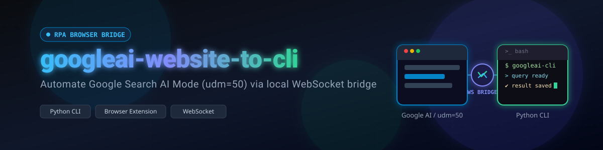

<p align="center">
  
</p>

<p align="center">
  <a href="https://github.com/ishandutta2007/Awesome-Awesome-Awesome"></a><a href="https://discord.gg/jc4xtF58Ve"></a>
  <a href="https://pypi.org/project/googleai-website-to-cli/"></a>
  <a href="https://github.com/ishandutta2007/googleai-website-to-cli/blob/main/LICENSE"></a>
  <a href="https://github.com/ishandutta2007"></a>
</p>

# 🚀 googleai-website-to-cli

> **SEO Description**: RPA-powered command line interface (CLI) and browser extension automation tool for Google Search AI Mode (`https://www.google.com/search?udm=50`). Convert Google AI search sessions into automated terminal workflows without API keys or bot-detection blocking.

**RPA-powered CLI tool that converts Google Search AI Mode (`udm=50`) interactions into a command-line interface using a paired browser extension.** 🤖⚡

Instead of reverse-proxying API calls or using detectable headless browsers, this tool uses **real browser automation** -- a lightweight browser extension runs inside your actual browser (Edge or Chrome) and communicates with the CLI via a local WebSocket bridge. 🔌🌐

---

## 🛠️ How It Works

```
+-------------------+      WebSocket (localhost)      +-------------------------+
|   googleai-cli    | <===========================>  |  Google AI CLI Bridge   |
|   (Python CLI)    |      ws://127.0.0.1:18768      |  (Browser Extension)    |
+-------------------+                                 +-------------------------+
          |                                                       |
     Reads prompt                                           Runs inside your
     from file                                              real browser
          |                                                       |
     Outputs response                                       Has access to your
     to terminal                                            Google AI (udm=50)
     or file                                                session & DOM
```

1. **CLI starts** a local WebSocket server 💻
2. **Extension connects** (auto-reconnects every few seconds) 🔄
3. **CLI sends commands**: find Google AI tab (`udm=50`), input prompt, wait for response, extract result 🎯
4. **Extension executes** DOM operations in your real browser ⚡
5. **CLI receives** the result and outputs it ✨

## ✨ Features

- 🛡️ **No bot detection blocking** -- uses your real browser session, not Selenium
- 📑 **Tab management** -- finds existing `udm=50` tabs or opens new ones
- 🧠 **Smart DOM interaction** -- handles dynamic inputs/textareas and triggers form submit
- ⏳ **Response monitoring** -- monitors action footers and content stabilization
- 📦 **Result extraction** -- extracts code blocks or full response text (via copy button or fallback)
- 🎨 **Rich terminal UI** -- spinners, panels, and syntax highlighting
- 📝 **File output** -- optionally append results to a file

## 📥 Installation

### 1. Install the Python CLI 🐍

```bash
pip install googleai-website-to-cli
```

Or from source:

```bash
git clone https://github.com/ishandutta2007/googleai-website-to-cli.git
cd googleai-website-to-cli
pip install -e .
```

### 2. Install the Browser Extension 🧩

1. Open **edge://extensions** (in Edge) or **chrome://extensions** (in Chrome) 🌐
2. Enable **Developer mode** ⚙️
3. Click **Load unpacked** 📁
4. Select the `extension/` folder from this repository 📂
5. The "Google AI CLI Bridge" extension will appear with a status icon 🟢

> **Note:** The extension auto-connects to the CLI when it's running. You'll see a green indicator in the extension popup when connected.

## 💡 Usage

### Basic Usage 💻

```bash
# Send a prompt and display the result in terminal
googleai-cli prompt.txt

# Send a prompt and append the result to a file
googleai-cli prompt.txt -o output.py

# Extract full response text instead of code blocks
googleai-cli prompt.txt --full-response -o response.md
```

### Arguments 📋

| Argument | Required | Description |
|---|---|---|
| `prompt_file` | Yes | Path to a text file containing the prompt |
| `-o, --output FILE` | No | Path to output file (result appended). If omitted, prints to terminal |
| `-w, --max-wait SECONDS` | No | Maximum wait time for response (default: 180s) |
| `-p, --port PORT` | No | WebSocket bridge port (default: 18768) |
| `--full-response` | No | Extract full response text, not just the last code block |
| `-b, --browser` | No | Browser to use: `edge` (default) or `chrome` |
| `-v, --verbose` | No | Enable debug logging |
| `--version` | No | Show version |

### Examples 🌟

```bash
# Create a prompt file
echo "Explain quantum computing in simple terms" > prompt.txt

# Run with terminal output
googleai-cli prompt.txt --full-response

# Run with file output and extended timeout
googleai-cli prompt.txt -o explanation.txt -w 300

# Run with verbose logging for debugging
googleai-cli prompt.txt -v
```

## 🏗️ Architecture

### Python CLI (`src/googleai_website_to_cli/`) 🐍

| Module | Purpose |
|---|---|
| `cli.py` | CLI entry point, argument parsing, output formatting |
| `browser.py` | WebSocket bridge server (`GoogleAIBridge`) |
| `googleai.py` | High-level command orchestration (`GoogleAIAutomation`) |

### Browser Extension (`extension/`) 🧩

| File | Purpose |
|---|---|
| `manifest.json` | Extension config (Manifest V3) |
| `background.js` | Service worker: WebSocket client, tab management (`udm=50`) |
| `content.js` | Content script: DOM operations on `google.com/search?udm=50` |
| `popup.html/js` | Status popup showing connection state |

### Communication Protocol 💬

Commands flow as JSON over WebSocket:

```json
// CLI -> Extension (command)
{"id": "uuid", "type": "send_prompt", "prompt": "Explain quantum computing"}

// Extension -> CLI (response)
{"id": "uuid", "success": true, "data": {"submitted": true}}
```

Available commands: `ping`, `find_googleai_tab`, `activate_tab`, `open_googleai_tab`, `send_prompt`, `check_response_status`, `extract_last_code_block`, `extract_full_response`.

## 📦 Dependencies

| Package | Purpose | Pricing | Free Tier / Limits |
|---|---|---|---|
| `websockets` | WebSocket server for CLI-extension bridge | Free / Open Source | MIT License (No limits) |
| `rich` | Terminal UI (spinners, panels, syntax highlighting) | Free / Open Source | MIT License (No limits) |
| `chardet` | Character encoding detector for file inputs | Free / Open Source | LGPL License (No limits) |

## 🔍 Troubleshooting

| Problem | Solution |
|---|---|
| "Extension did not connect" | Make sure the Google AI CLI Bridge extension is installed and enabled in Edge/Chrome |
| "No active Google AI tab found" | Open `https://www.google.com/search?udm=50` or let the tool open it for you |
| "Could not find prompt input box" | Make sure the Google Search AI Mode page is fully loaded |
| "No code blocks found" | Use `--full-response` to get the entire response text |
| Port conflict on 18768 | Use `-p 18769` to specify a different port |
| Response timeout | Increase wait time with `-w 300` |

## 📄 License

[MIT](LICENSE)
